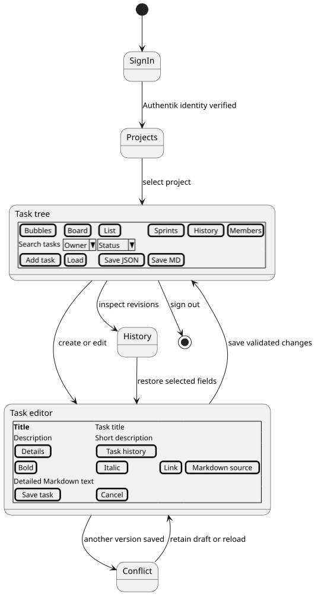
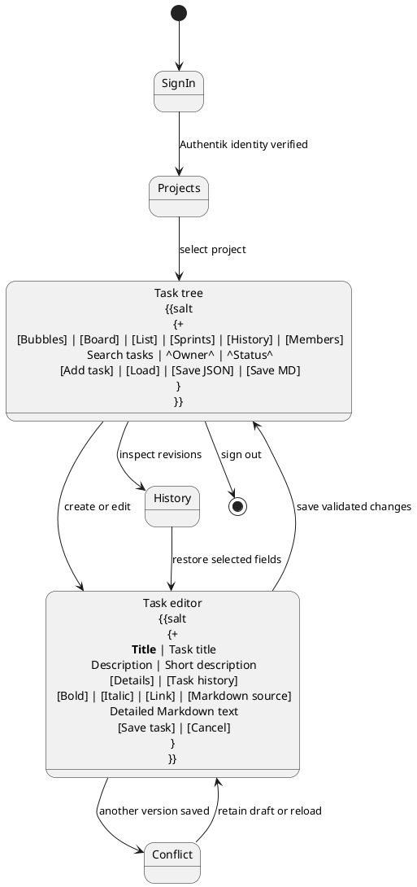
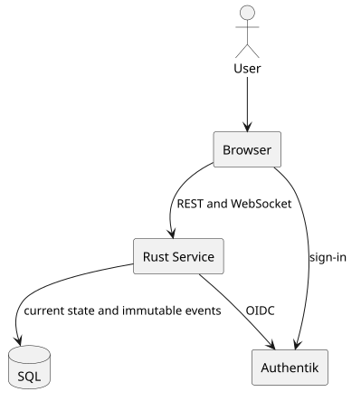
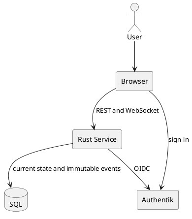

# Architecture

## 1. Introduction and Goals

An authenticated user selects a project, imports or creates a task tree, navigates Bubbles, Board or the nested Markdown List, saves changes and inspects or restores previous versions. Sprints and dependencies organise delivery without replacing the hierarchy.

Workflow source

## 2. Architecture Constraints

Rust backend, React frontend, SQL portability, OIDC-only authentication and the established npm/Docker-image conventions govern implementation. The final image is headless and non-root. The local identity provider and databases run as actual services.

## 3. Context and Scope

The browser communicates with one same-origin service. Authentik establishes identity. PostgreSQL, MySQL or MariaDB stores data. Markdown and JSON exchange project contents. The original Python renderer generates SVG and interactive HTML; the browser converts the SVG to PNG. Database backups belong to the deployment operator.

## 4. Solution Strategy

Axum handles HTTP, sessions, CSRF and WebSockets. SeaORM executes portable SQL. Utoipa derives the API contract from Rust. React uses the same task state for Bubbles, Board and List; Milkdown provides formatted Markdown editing. SQL transactions atomically update project state and append history.

## 5. Building Block View

Diagram source

`src/model.rs` defines persistent documents and API values. `src/markdown.rs` parses and renders the task grammar. `src/service.rs` implements authentication, authorisation, transactions, events and delivery. Frontend components separate Bubbles, the editor, History and sprint planning. `src/renderer.rs` invokes the staged canonical `renderer/task-tree.py` through a JSON adapter. Bubbles and exports use its same drawing functions, fonts and HTML. The HTML builder emits `task-tree-view`; React imports the same generated custom element and keeps it mounted across view switches. A browser bridge connects it to task navigation and editing. Diagram responses deny framing.

## 6. Runtime View

OIDC sign-in creates a short-lived state/nonce/PKCE record. The callback consumes it once, validates the signed ID token and establishes a new opaque session. Role configuration is evaluated on requests. A task save validates access, version, hierarchy and planning rules, updates the project with compare-and-swap, inserts its immutable event and commits. WebSocket listeners receive an immediate in-process signal and also query the durable stream, supporting multiple instances and reconnects. Restore reads a historical snapshot, copies selected fields into a current task and records a new event.

Project loading validates the complete document before an atomic create or merge selected by its canonical title. Project lifecycle operations use administrator authorisation, CSRF protection and optimistic sequence checks. Session validity uses a separate authenticated WebSocket, an explicit invalid-session close code and a server-derived local expiry. A browser session generation rejects responses completing after invalidation; cross-tab invalidation clears the complete application state.

## 7. Deployment View

The Dockerfile builds frontend assets, a static Rust binary and the Python/Pillow/Fontconfig runtime using build-only base images, then copies their runtime files into `mwaeckerlin/scratch`. The final image contains no shell or package manager. Compose builds that image, a local Traefik image and an Authentik image containing an application and group blueprint. Traefik publishes the sole loopback port, default 8326, and routes `/auth/` to Authentik and `/todo/` to TODO. The file provider requires no Docker socket. Named volumes retain database and identity media state. Production requires HTTPS and external secret provisioning. A provider-address migration can retain the previous identity namespace explicitly while requiring tokens from the new configured issuer.

## 8. Cross-cutting Concepts

Identity uses issuer plus subject; task owners reference its immutable local digest. Membership scopes projects while role claims or environment assignments determine capability. Task IDs remain stable and human references support Markdown merge. Project sequence numbers order events, and task versions detect stale edits. JSON-imported history identifies its importing actor and source revision. No import changes membership or role configuration.

## 9. Architecture Decisions

REST handles mutations and snapshots; WebSockets announce committed changes and replay by sequence. Project documents stored as SQL text keep the transaction portable across engines. Separate event rows retain complete history. Explicit field restoration avoids silent overwrites and preserves later versions. React/Vite avoids a second server runtime in the deliverable.

## 10. Quality Requirements

Browser journeys exercise persistence and rendered behaviour in two engines. Negative cases cover malformed imports, denied access, stale writes and dependency cycles. The database matrix covers the supported engines. Image checks inspect the actual filesystem and runtime identity. Rendered screenshots and paper exports support visual review.

## 11. Risks and Technical Debt

Each project is one optimistic write unit, so concurrent edits to unrelated tasks can still conflict. Clients retain drafts and require explicit reconciliation. Identity-provider roles are cached for the application session; shorter session duration reduces revocation delay. A JSON file supplies historical author claims, which remain marked as imported. An export containing complete history can contain text removed from the current task and requires corresponding protection.

## 12. Glossary

| Term | Meaning |
| --- | --- |
| Task | One node with properties, text, assignment and an optional parent |
| Project | A task tree, sprint list, membership scope and history stream |
| Revision | An immutable event with author, time and before/after values |
| Revert | A new save restoring selected values from an earlier revision |
| Sprint | A dated delivery interval with goal and status |
