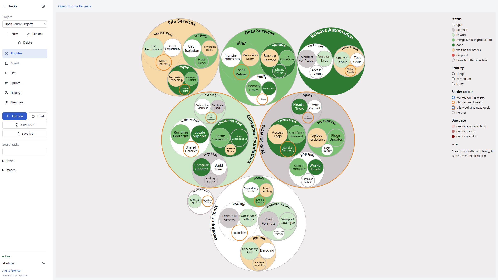
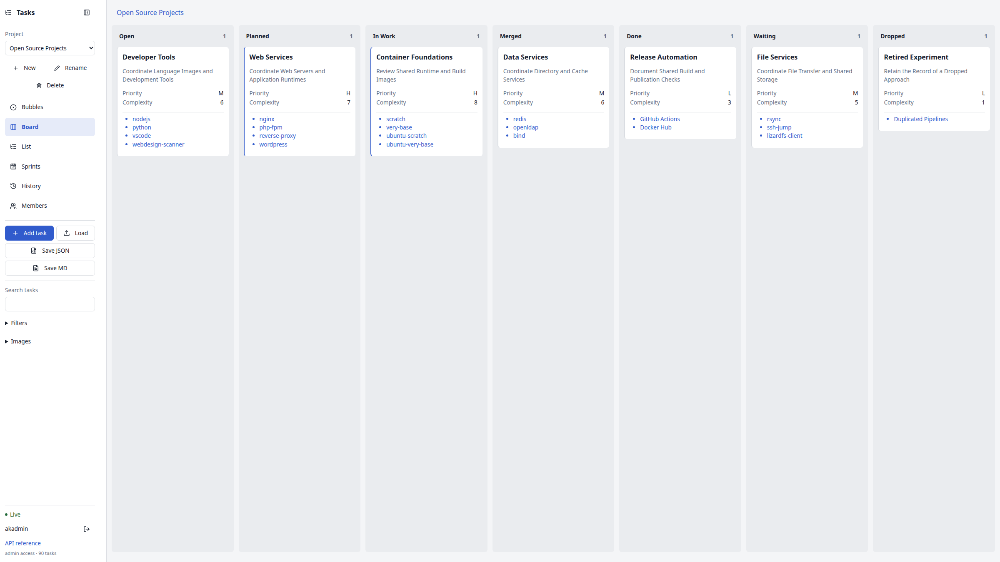
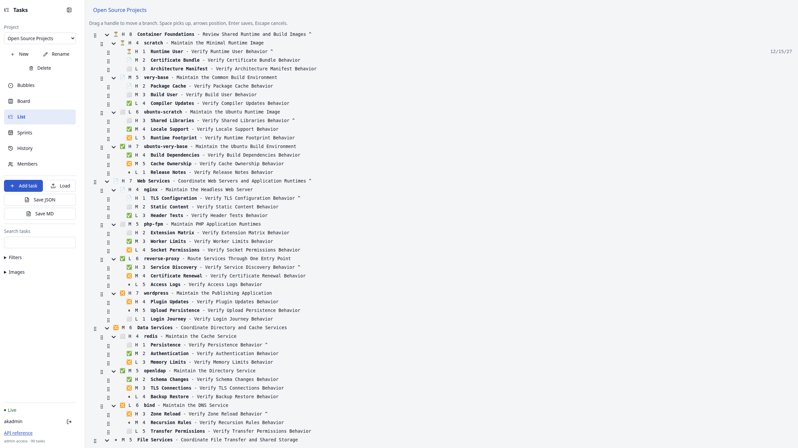

# TODO

Manage one task tree as nested bubbles, a status board or an indented Markdown list, with sprints, dependencies and permanent edit history.



The same complex sample in **Bubbles**, **Board** and **List**. The example groups Docker foundations, web services, data services, file services, developer tools and release automation into one navigable hierarchy. Its tasks and dates are illustrative.

| Board | List |
| --- | --- |
| [](doc/screenshots/board.png) | [](doc/screenshots/list.png) |

## Planning Overview

For teams considering an alternative to Trello, TODO combines a familiar status board with an explicit task hierarchy. A large initiative, a repository and an individual implementation task can remain related while each keeps its own status, priority and history. Switching views changes the presentation of the same tasks. Open a parent through its bubble or a board card's child-title list; the breadcrumb returns to ancestors.

The bubble view shows several hierarchy levels at once. Enclosing circles reveal which work belongs together; their area reflects complexity, so substantial branches remain visible among small tasks. Fill shows status and approaching deadlines, border thickness shows priority, and week markers distinguish recent work and next-week plans. Mixed progress inside a parent stays visible: a completed child and an overdue child appear together. This makes the view useful for reviewing the scope and distribution of work before opening individual cards. Complexity is a relative indication of work, not a delivery-date estimate.

Markdown keeps the hierarchy readable outside the service and suitable for version control. JSON additionally retains sprints, dependencies and full history. Every text save and property change can be inspected and restored as a new revision. Self-hosted Docker deployment and existing OIDC identities keep storage and access under the operator's control. The board supports status changes through drag and drop; the list supports moving complete branches.

Trello import, two-way synchronisation, comments, attachments, WIP limits and notification delivery are outside this release. Evaluate these requirements before replacing an existing installation.

Sign in through Authentik, import a Markdown task list, assign work and collaborate across browser tabs. Every save records its author, time and complete text. Restore individual fields from any revision without removing subsequent history.

[Features](FEATURES.md) · [Tests](TESTS.md) · [Architecture](ARCHITECTURE.md) · [Contributing](CONTRIBUTING.md) · [Changes](CHANGELOG.md)

The [development backlog](TODO.md) records existing F1–F12 capabilities as Done and proposed additions as Open. It includes task discussions through existing open-source chat software, notifications, development integrations, personal views and planning improvements. Provider choices and priorities remain proposals; the initial release entry retains outstanding release preparation and verification.

## Stack

Rust with Axum/Tokio handles the API and live connections; SeaORM provides PostgreSQL, MySQL and MariaDB drivers. React with Vite builds static browser assets that the Rust executable embeds. The original Python task-tree renderer produces the bubble view and its exports. Next.js would add a server runtime and is useful when server rendering is needed; this authenticated workspace uses client rendering. Axum integrates with Tokio, Tower middleware and utoipa for the generated OpenAPI contract. Actix Web is another Rust option; Django or Rails provide more built-in administration, with a change of backend language.

## Local Setup

Install Docker Compose and Node.js with npm. Start the complete local demonstration:

```bash
npm start
```

This builds the headless application, Traefik and an Authentik image containing the local application blueprint and the groups `todo-admin`, `todo-editor` and `todo-reader`. Compose starts the task database, Authentik's database, Authentik server and worker. Traefik publishes the single port `8326`: `/todo/` serves TODO and `/auth/` serves Authentik, including its administration and OIDC endpoints. Open `http://localhost:8326/todo/`, select **Sign in with Authentik**, and use `akadmin` with `local-test-password`. Initial database migration and blueprint installation take longer than subsequent starts. If the provider is still starting, repeat sign-in once Authentik is ready.

The example is exclusively a local test environment: it binds to loopback and uses published demonstration credentials. It explicitly permits HTTP. Deployments require their own database credentials, OIDC client, signing configuration and HTTPS.

```bash
npm run start:daemon
npm stop
```

Stopping retains data. `npm run clean` removes the local named volumes and their contents. Set `TODO_PORT` in the shell or Compose environment to change the single published port. `BIND_ADDRESS` defaults to `127.0.0.1`; exposing the demonstration stack on another interface exposes its known test credentials. The application, Authentik and databases have no direct published ports. Traefik uses an image-contained file configuration and has no Docker socket or enabled dashboard.

Open [Authentik administration](http://localhost:8326/auth/if/admin/) with `akadmin` and `local-test-password`. Under **Directory → Groups**, select **todo-admin**, open **Users**, and add the existing user. The `todo-editor` and `todo-reader` groups grant the corresponding application roles. These groups grant no Authentik administration rights. After changing groups, sign out of TODO and sign in again. The provider's group claims are refreshed at sign-in. Create additional accounts under **Directory → Users**, set their password and assign their TODO group. Editors and readers additionally require project membership through TODO's **Members** view.

The sign-in screen and browser sign-in errors include **Sign out of Authentik**, which opens the provider's published OIDC end-session endpoint. On the provider's confirmation page, select **Log out of authentik** to leave the provider account before signing in with another user. A missing TODO role leaves these controls available. TODO's **Sign out** immediately removes project data and drafts and revokes the application session, including after its role mapping is removed. Authentik maintains its own session separately. Deleting the local volumes resets provider accounts as well as project data; the fresh bootstrap account is `akadmin`.

## Sample

The complex example is [tests/fixtures/opensource.md](tests/fixtures/opensource.md). Select **Load** and choose that file to create **Open Source Projects**, or merge its stable task references into a project with that title. It includes all seven statuses, three levels, different priorities and complexities, illustrative dates, next-week markers and Markdown detail chapters. It refers to actual repository names and makes no claim about their current backlog.

To reproduce the README screenshots after starting the local demo:

```bash
npm run screenshots
```

This signs in to the local test provider, loads that separate example project and captures the running Bubbles, Board and List views under `doc/screenshots/` at a desktop viewport. Existing projects retain their data. Repeating the command merges the sample by its identifiers.

Create a populated local sample with real Authentik sign-in:

```bash
npm ci
npm run setup:browsers
npm run demo
```

The command builds missing images and starts a separate Compose project with its own data volumes, signs in through Authentik and fills an empty **Demo** project with fifteen tasks, nested views, all statuses, owners, dates, Markdown details, saved revisions, a sprint and dependencies. It prints the project address at `http://localhost:8326/todo/` and saves a screenshot under `artifacts/demo.png`. `DEMO_PROJECT_NAME` selects another project name. Repeating the command retains populated project data and previously completed setup steps; its recorded project ID also retains a renamed sample. Demo startup uses the local database and loopback interfaces, independently of inherited deployment database/binding settings. `npm run build` refreshes existing images after source changes.

```bash
npm run demo:stop
```

Stopping the sample retains its data. Its resolved Compose configuration is kept in a separate temporary runtime directory, with the directory recorded under `artifacts/demo-runtime.json`. This separates the running sample from build and test environments in the checkout. The regular `npm stop` command controls the normal Compose example.

## Task Views

Create a project, add tasks or load a `TODO.md` file. The **Bubbles**, **Board**, **List**, **Sprints**, **History** and **Members** tabs share the same data. The collapsible left sidebar contains project selection, actions, search, filters, account controls and API reference. The selected view fills the remaining viewport below one compact Markdown-title breadcrumb. The project name is the document title: the first level-one heading before the task list determines the name shown in project selection, the breadcrumb and the browser tab, including existing projects. Load requires a Markdown document heading or a JSON project title. The legacy project import API retains the current name for a heading-free document, or adopts the exported JSON name when present. A document heading takes precedence over an obsolete JSON name. **Rename** changes the shared name and heading, with conflict checking and complete History. Small screens initially hide the sidebar; the **Expand sidebar** icon opens it.

In Bubbles, click a circle to descend and click the background or press Escape to ascend. The opened parent retains its status or due-date fill behind its children, including overdue red. Double-click a title to edit it; double-click another part of a circle to open all fields. Hover shows one formatted popup at the cursor with the title, description, status, priority, complexity, optional date and planning marker. A right-click opens owner, status, priority and date controls at the pointer. Circle controls support Enter, F2 and the context-menu key.

On narrow screens, Board presents the seven status groups vertically with full-width cards. Bubbles use the full width with an expandable **Legend** below the drawing. **Task level** selects the project or any ancestor, and **Up** returns one level. The sidebar remains collapsible. Editor fields, tables, code, History and planning wrap within the screen; navigation requires vertical scrolling only.

In Board, each column represents one status: Open, Planned, In Work, Merged, Done, Waiting or Dropped. Empty columns occupy half the width of occupied columns and remain drop targets. A single card click opens its editor; a double-click opens its child board. A list of child titles also opens that child board with one click. The title supports keyboard editing, and the child list supports Enter or Space. Blue card borders identify High priority; grey borders identify the other priorities. Dragging between columns changes only that task's status. Use the breadcrumb to return to a parent or the project root. Search and owner, status, priority, date and sprint filters work in both views.

Complexity ranges from zero to nine. It determines circle area within the same hierarchy level and is not a calendar duration. Priority determines border thickness. Status determines fill, while approaching due dates take precedence for open work. Orange marks next-week work and blue marks recent changes. Completed, merged and dropped tasks retain their status fill.

## Text and History

The **Clear** control beside **Due date** empties the editor's date. **Save task** persists the removal and records it in History; **Cancel** permits discarding that draft. The context menu's **Clear due date** saves immediately. Both actions are disabled for readers and when no date is set.

The viewport-sized editor contains title, description, status, priority, complexity, date, parent, identifier, owners, sprint, dependencies, next-week marker and archive flag. Details use Milkdown Crepe's built-in persistent Icon TopBar, with a heading selector, lists, code, tables, undo, redo and links. **Markdown source** toggles the source. Owners and dependencies use searchable Headless UI multiple selection, with complete titles and individually removable selections. The identifier initially remains read-only; **Change identifier** enables deliberate changes and explains how an older Markdown reference can create another task on loading. **Save task** is the first footer action, followed by **Cancel**; desktop detail text scrolls within its own area. Headings inside details start at level two. Raw HTML is not executed. Save explicitly; saving and changing editor modes read the current formatted document immediately. Closing an edited task asks whether to retain or discard its draft. New drafts receive a stable UUID, so retrying a create request preserves one task. Archiving a parent hides its subtree until archived tasks are included or the parent is restored; JSON retains the complete subtree and history.

The project History tab lists author, timestamp, operation and changed properties. Task history lists complete snapshots of every save, including saves that do not change a field. Select a revision to read its title, description and details and compare before/after data. Select fields or the whole task and restore. Restoration creates a new revision. Readers can inspect formatted details, source and history; editors can restore. Pagination loads older revisions without truncating their stored text. While saving or restoring, the editor disables changes and closing until the request completes.

Imported JSON revisions retain their source author and time and are marked as imported, with the importing user recorded. These are records supplied in the import file; ordinary service-authored revisions are recorded directly by the server.

History initially displays the newest revision. Further changes display **Show new revisions** while retaining the current revision list, selected revision, loaded older pages and scroll position. That action explicitly loads the latest revisions. Imports, changed Markdown preambles and project renames are recorded alongside task-property edits.

Live updates preserve the open popup, draft, focus, cursor, text selection, diagram level and zoom, and scroll positions. The shared diagram element stays mounted across view switches while its task elements update. Unchanged circles and labels retain their DOM identity. Task and sprint drafts retain their saved baseline even before typing; **Reload current version** or **Reload current sprint** explicitly replaces a conflicting draft. A stale save preserves the text and reports the conflict. Task conflict and validation messages occupy their own row above the form, keeping editor mode controls reachable.

Logout, an expired session or an invalid session removes every project view, popup and unsaved draft from the browser immediately. Logout propagates across tabs. A separate authenticated session connection also covers tabs without a selected project; its invalid-session close code is `4001`. The browser schedules local clearing at the server-provided expiry and validates sessions on foreground return. Request responses from an ended session cannot restore old data. A project permission error remains distinct from an invalid session.

Restoring owners requires every selected identity to have signed in to this installation. A historical revision with unknown owners remains readable; restore its text fields separately or sign in with those identities first. A rejected restoration leaves the task and history unchanged.

## Sprints and Dependencies

Create a sprint with a goal, dates and status. Its default duration is fourteen days; `SPRINT_DAYS` changes that default. One sprint may be active per project. Tasks without a sprint remain in the backlog. Assigning a sprint retains the task's status. Concurrent sprint edits retain their original sequence and draft; reload the current sprint before reconciling a conflict.

Sprint defaults, due-date filters and warning spans use the browser's local calendar day. Weekly border markers use its local Monday boundaries, including daylight-saving changes, in the view and picture exports. The diagram API accepts both `week_start` and `week_end` as timestamps; omitting both selects UTC calendar weeks. Daylight-saving changes do not shorten or extend a warning span. Dates remain calendar dates; history timestamps are displayed in local time.

Dependencies reference tasks in the same project. Cycles are rejected. With `ENFORCE_DEPENDENCIES=true`, all immediate prerequisites must be Done before a task can enter In Work or Done. No dependent status is changed automatically. A reopened prerequisite appears as incomplete and blocks subsequent start/completion attempts. Set the option to `false` for advisory dependencies.

## Markdown Format

The existing two-space indentation, seven status icons, optional priority, complexity, optional date, task identifier and next-week marker remain supported. Owners follow the description in brackets, before the identifier:

| Icon | Status |
| --- | --- |
| ⬜ | Open |
| 📄 | Planned |
| ⏳ | In Work |
| 🔀 | Merged |
| ✅ | Done |
| ⏸ | Waiting |
| ❌ | Dropped |

```markdown
- ⏳H5 20261115 Dashboard - Improve Navigation [alice,bob] #dashboard ^
  - ⬜M2 Links - Add Section Links #links

# dashboard Dashboard

## Acceptance Criteria

- Navigation works on desktop and mobile.
```

Explicit IDs remain stable when titles or positions change. Tasks without IDs receive them on import or creation. For unchanged imported entries, generated IDs remain consistent across repeated imports; description edits do not change them. Retain exported IDs when renaming or moving entries in an external file so their identity remains explicit. Detail chapters follow the whole task list and start with `# ID Title`; headings within the chapter start with `##`. Code fences, indented code, literal HTML examples, lists and Markdown hard breaks inside details remain content. Markdown export checks its own round trip and refuses content whose unfinished Markdown blocks would consume another task's chapter; complete those blocks or use JSON export to preserve the source.

An extra space after complexity distinguishes an undated title beginning with eight digits from a due date. The exporter preserves this distinction; keep the spacing when editing such entries by hand:

```markdown
- ⬜M1  20261101 Campaign - No Due Date #campaign
```

The **Load** action uses the browser's native file chooser and detects Markdown or JSON from its contents. The document title selects the project. Administrators can create a missing project; loading an existing title merges task changes by identifier and preserves absent tasks. Editors can load into their assigned projects. Markdown requires a document heading before the task list; JSON uses its document heading or project name. **New project**, **Rename project** and **Delete project** are administrator actions. Deletion confirms the project name and removes its tasks, sprints and history atomically; a concurrent edit requires reloading the confirmation. Selecting a file applies it immediately after atomic validation, with every change recorded in History. Cancelling changes nothing. Unknown owners require those users to sign in or the names to be corrected. A name in a file grants no access. Invalid input leaves the project and history unchanged; a concurrent project change requires selecting the file again. Integrations may still request API dry-run validation.

Different identities can have the same remembered username after a provider account is renamed or its name is reused. Assignment controls and History distinguish such names with a short stable user ID. Markdown import and export reject ambiguous owner names; JSON preserves the stable IDs. Signing in again with a renamed account refreshes its display name while preserving its assignments and project access.

Markdown represents the task-tree fields above. JSON additionally represents sprints, dependencies, archived tasks and complete history. JSON import validates schema version one, task graphs, saved snapshots and sprint constraints before applying the file. The legacy import API retains merge/replace, project and sprint history as well as task revisions, deduplicates imported source revisions and preserves the target project's access controls. Importing membership or roles from a file is prohibited. Keep JSON exports protected as they contain the entire saved text history.

## Exports

The **Save MD** and **Save JSON** actions download the complete project immediately. **Images** in the sidebar contains **Export scope**, **Save SVG**, **Save PNG** and **Save HTML**. The scope selector chooses the complete filtered diagram or the current subtree for picture exports. The HTML has embedded task data, drawing and navigation code and requires no server. SVG and PNG use the same circle renderer as the application. Task and history JSON exports cover the complete project.

The bubble drawing and standalone HTML use the same `task-tree-view` custom element generated by the original `build-todo-tree.py`, including packing, curved parent labels, colours, fonts, borders, due-date shading, legends and navigation. React imports that exact element directly. Its Noto Sans font files are included under their original licence. `renderer/render.py` adapts stored tasks to that renderer; the browser bridge adds editing gestures. Every fitted SVG label remains in the shared HTML element, including small leaves. Enlarging the browser increases the detail visible in this complete vector text. Rust verifies project access for every diagram request. The image includes Python, Pillow with Raqm font shaping and Fontconfig for this renderer, with no shell or package manager. Import alone does not mark every task as worked this week; ordinary task edits supply the weekly work records.

`npm run image:save` writes the built image to `artifacts/todo-image.tar`, its SHA-256 and image ID to `artifacts/image.json`, and the generated contract to `artifacts/openapi.json`. The full test run also creates these files. Load the image archive with `docker load --input artifacts/todo-image.tar`.

Database backup and restore operations belong to the deployment operator and are outside this project. Exporting project data is separate from backing up the database, identity configuration or sessions.

Automated validation creates its own Compose project and uses that project's SQL services. It overrides inherited `TODO_DATABASE_URL` and `BIND_ADDRESS` values to keep the initial database local and published test ports on loopback; the database matrix then selects its own MySQL and MariaDB services. A failed environment build stops dependent checks immediately and records the failure in `artifacts/results.json`, with available service logs in `artifacts/compose-failure.log`. Normal deployment commands retain their configurable environment values.

`npm run prepare:renderer` compiles the canonical builder's custom element for React. Build and local-start commands run this preparation automatically. The complete canonical source is included in `renderer/task-tree.py`; a fresh clone requires no other checkout. `renderer/provenance.json` records its SHA-256, checked by the renderer suite together with complete SVG/HTML parity. `TODO_RENDERER_SOURCE` optionally supplies an external canonical file for byte-for-byte comparison and staging. The browser module is generated and has no independent drawing implementation.

## Nested List

Open an existing task through its bubble, list row, board card or a double-click on its breadcrumb title.

Select **List** between Board and Sprints to see the complete indented Markdown task list. Drag a left handle before, after or into another task to move its whole branch. The top and bottom quarters of a row insert beside it; its centre nests the branch. The Project root area places it at the end of the document. Touch uses the same handles. With a focused handle, Space picks up, Up/Down choose sibling order, Right nests, Left moves out, Enter saves and Escape cancels. Search retains matching ancestors. Dates align at the right edge in the browser locale's short format; title and description use an ellipsis when space is limited. The full text remains stored and available in the editor and exports.

Moves preserve task contents and descendants, record changed parents and order in History and update other clients. Concurrent changes reject the entire move and reload the current tree. Readers inspect the list with disabled handles. Double-click a title to edit it, double-click another part of a row for all details, or right-click for the existing property menu.

## Authentication

Configure an Authentik confidential OAuth2/OIDC provider with Authorization Code, PKCE, signed ID tokens and an exact callback URL of `<APP_ORIGIN><APP_BASE_PATH>/auth/callback`. Enable `openid` and `profile` and include the configured role claim in the ID token. The service checks signature, algorithm, issuer, audience, expiry, state and nonce. User identity is the configured issuer and immutable subject; the username is its display name.

The role claim defaults to `groups`. `OIDC_ROLE_MAP` defaults to:

```json
{"todo-admin":"admin","todo-editor":"editor","todo-reader":"reader"}
```

`OIDC_SUBJECT_ROLES` defaults to `{}` and maps immutable subjects from the configured issuer directly to application roles. A direct subject assignment overrides role-claim mappings. With several mapped groups, administrator takes precedence over editor and reader. An unmapped user is refused. Login order never grants administration. The local Compose example creates the three TODO groups idempotently during deployment and explicitly maps Authentik's existing `authentik Admins` group to admin for the bootstrap account. Existing user memberships remain unchanged when the blueprint is applied again.

When moving the same provider to another public address, set `OIDC_IDENTITY_ISSUER` to its previous issuer URL before sign-in. Token validation continues to require the new `OIDC_ISSUER`; the previous URL retains the existing identity digest and therefore assignments, memberships and historical authors. This setting trusts the operator's assertion that both addresses identify the same provider and subject namespace. Leave it unset for new installations and different providers. The demo command retains its recorded identity namespace automatically when moving an existing sample behind Traefik.

An authenticated user's `/api/me` response includes `identity.subject` for explicit subject mappings. The local Authentik image follows the vendor release recorded in its Dockerfile because that registry publishes no `latest` tag; `docker compose build --build-arg AUTHENTIK_TAG=<release>` selects another vendor release.

Administrators access every project, create, rename and delete projects, and control membership. Editors edit projects they belong to. Readers inspect and export assigned projects. Project membership restricts scope; Authentik and environment mappings determine the role. Assignment as a task owner does not grant project membership. Environment mappings are re-evaluated for existing sessions on each request. Changed identity-provider groups are read at the next sign-in; the application session expiry bounds the cached group lifetime.

Opening Members, a task editor or a context menu refreshes the known-user list, so newly signed-in users become available for membership and assignment without reloading the application.

## Configuration

| Variable | Default | Purpose |
| --- | --- | --- |
| `DATABASE_URL` | `sqlite://todo.db?mode=rwc` | SeaORM connection URL; production uses PostgreSQL, MySQL or MariaDB |
| `DATABASE_URL_FILE` | unset | Read the database URL from a runtime secret file |
| `APP_ORIGIN` | `http://localhost:8080` | Exact public origin; Compose uses `TODO_PORT`, default `8326` |
| `APP_BASE_PATH` | empty | Public path prefix; Compose uses `/todo`; the proxy strips this prefix before forwarding |
| `OIDC_ISSUER` | required | Exact public issuer, including the application path |
| `OIDC_IDENTITY_ISSUER` | `OIDC_ISSUER` | Stable identity namespace when the same provider moves address; token validation still uses OIDC_ISSUER |
| `OIDC_INTERNAL_ORIGIN` | unset | Optional internal origin for back-channel calls to that same provider |
| `OIDC_CLIENT_ID` | `todo` | Confidential client identifier |
| `OIDC_CLIENT_SECRET` | required | Client secret; prefer its file option in production |
| `OIDC_CLIENT_SECRET_FILE` | unset | Read the client secret from a runtime secret file |
| `OIDC_ROLES_CLAIM` | `groups` | Array claim containing identity-provider roles |
| `OIDC_ROLE_MAP` | shown above | JSON object mapping claim values to application roles |
| `OIDC_SUBJECT_ROLES` | `{}` | JSON object assigning roles to immutable subjects |
| `SESSION_SECONDS` | `28800` | Session lifetime; lower values reduce the cached provider-role lifetime |
| `ALLOW_INSECURE_HTTP` | `false` | Explicit local-test exception for HTTP and non-Secure cookies |
| `SPRINT_DAYS` | `14` | Initial duration in the sprint form |
| `ENFORCE_DEPENDENCIES` | `true` | Require completed prerequisites before starting/completing work |
| `MAX_REQUEST_BYTES` | `16777216` | Maximum request body size |
| `MAX_TREE_DEPTH` | `64` | Maximum task-tree depth, including a moved task’s descendants |
| `MAX_WEBSOCKETS` | `1000` | Connection budget per application process |
| `REQUESTS_PER_MINUTE` | `6000` | Request budget per peer IP and application process |
| `LISTEN_ADDRESS` | `0.0.0.0:8080` | Listener; container port mapping controls external exposure |
| `RUST_LOG` | `info` in the image | Server log level |
| `RENDERER_PYTHON` | `python3` | Python executable for the original task-tree renderer |

Application data, history and sessions persist in the selected SQL database. The example mounts PostgreSQL's data under `/var/lib/postgresql` and Authentik media under `/media` using named volumes. The runtime image has a read-only filesystem and no database volume of its own. SQLite's fallback is intended for development with an explicitly writable data location, rather than the read-only production image.

## Security

Use HTTPS/WSS behind a reverse proxy, configure exact public origins and permit WebSocket upgrades. The internal OIDC origin rewrites only the configured provider's back-channel origin and preserves its public issuer and host. It is useful for the loopback-only Compose example; normal production DNS can leave it unset.

Tokens remain on the server during the code exchange. The browser receives an opaque HttpOnly, SameSite session cookie; production requires Secure cookies. Mutations require a matching Origin and session-bound CSRF token. WebSocket handshakes require that same origin and session. Access is checked again while the socket remains open. Logout removes the session and closes its connections. Event delivery has bounded messages and send timeouts. Session records store hashed opaque session identifiers.

The application sends a restrictive Content Security Policy, clickjacking protection, content-type protection and no-store responses. The standalone diagram page permits its embedded renderer module by its SHA-256 digest. All application and diagram responses deny framing. Other inline scripts and raw Markdown HTML are blocked. Inline styles remain permitted for the editor and pointer-positioned menus; this permits a wider style policy while retaining the same-origin script restriction. HTTP mode and demonstration credentials are local-test exceptions and must not reach production.

The authentication design uses Authorization Code and PKCE as covered by [OAuth 2.0 Security Best Current Practice, RFC 9700](https://www.rfc-editor.org/rfc/rfc9700.html). WebSocket has no built-in application authentication; the session, exact-Origin check, encrypted transport, connection limits and continuing access checks address the controls described in the [OWASP WebSocket Security Cheat Sheet](https://cheatsheetseries.owasp.org/cheatsheets/WebSocket_Security_Cheat_Sheet.html). Task mutations use CSRF-protected REST requests; the WebSocket connection only delivers change notices.

## API

Open `/api/docs` for the generated operation list and same-origin request executor. `/api/openapi.json` is generated by utoipa from the Rust handlers and request/response types. With a session, obtain the CSRF token from `/api/me` and send it as `X-CSRF-Token` with the exact `Origin` on POST requests. The executor does this automatically.

```bash
npm run openapi
```

WebSocket events at `/api/projects/{project}/events?after=<sequence>` identify committed changes. Reconnect with the last received sequence; then read the current project snapshot, which includes tasks, sprints, membership and Markdown preamble at one sequence. The browser closes its connection when it reports offline and reconnects when it reports online, recovering missed changes. Every task save includes its expected version. A stale version returns HTTP 409 and preserves the browser's draft. Project imports, renames, membership changes and sprint changes similarly require the expected project sequence. Rename uses POST `/api/projects/{project}` with `name` and `expected_sequence`.

## Development

The root npm commands match the Docker-image family. Install Rust, Node.js, npm, Python with Pillow including Raqm font shaping, and Fontconfig for local development:

```bash
npm install
npm run prepare:rust
npm run build:app
```

When this checkout is itself a workspace inside another npm project, install its dependencies with `npm --prefix . ci`. Internal frontend builds, checks and dependency audits select this checkout explicitly so they use its own workspaces and lockfile.

The React assets are embedded into the Rust binary at build time. React and its external-store adapter share a bundle to preserve their dependency order. `npm run build` builds the actual Docker deliverable. Its final stage inherits `mwaeckerlin/scratch`; it contains the application binary and embedded assets, runs as the inherited unprivileged user, and contains no shell, Node.js, compiler or package manager.

The interface uses shared semantic colours, typography and spacing definitions. It retains the browser's preferred root font size; wider screens provide more room at that same text size. The formatted editor uses these same definitions. Sidebar actions wrap according to their content; its complete navigation and account controls share one vertical scroll area when height is limited. `npm run test:styles` checks the stylesheet contracts, while the browser journeys measure their rendered effect. The sidebar journeys inspect every visible control and text range across the complete viewport and font-size matrix and retain captures throughout its vertical scroll range.

The server handles Docker's SIGTERM and an interactive SIGINT through graceful HTTP shutdown. Signal registration errors stop startup before readiness is reported.

The GitHub caller uses the family's reusable `mwaeckerlin/scratch` workflow for native amd64 and arm64 builds on pushes to `master`, manual runs and hourly source checks. Its CI test command installs the runner's diagram tools and browser dependencies before the complete suite. Successful architecture builds publish Docker Hub tags through the shared workflow, including `latest`, the package version and dated tags. Publishing requires the repository's `DOCKERHUB_TOKEN` secret. Set a Docker Hub access token with read/write permission through the interactive prompt:

```bash
gh secret set DOCKERHUB_TOKEN --repo mwaeckerlin/todo
```

The Docker Hub username defaults to the GitHub owner, `mwaeckerlin`. A different account can be selected explicitly:

```bash
gh variable set DOCKERHUB_USERNAME --repo mwaeckerlin/todo --body ACCOUNT_NAME
```

After the Docker Hub repository and secret exist, a manual run can be started with:

```bash
gh workflow run docker.yml --repo mwaeckerlin/todo --ref master
```

The local Traefik image packages its file configuration. Only the application has a published image name; the local Authentik services are built under Compose-generated local names. `npm run deploy` pushes the application service. No registry publishing occurs during local verification.

All application SQL is accessed through SeaORM using portable statements. Each project holds its current task and sprint document with a compare-and-swap revision; immutable history lives in separate indexed event rows. This keeps an edit and its event atomic across the supported databases. Concurrent writes to one project can conflict; the client retains its draft for explicit reconciliation. Large or especially write-intensive projects may eventually require finer-grained rows, while retaining the existing API and event contract.

MySQL SHA-256 password authentication requires TLS. The local matrix uses `ssl-mode=required`; production should verify the server certificate and hostname. [Security Workarounds](SECURITY-WORKAROUNDS.md) describes the minimal upstream driver patch and the editor dependency override, their review dates and removal conditions.

## Verification

```bash
npm test
```

The runner checks browser-test discovery before building, the feature registry, Compose configuration, TypeScript, Rust parser tests, dependency audits, the built headless image, real Authentik sign-in and browser journeys in Chromium and Firefox. Journeys operate task properties, hierarchy changes, sprint dates, scoped exports, offline recovery and the generated API executor. They also verify retained scroll positions on populated boards and the rows and cells inserted by the editor's table command. It starts a dedicated test stack and removes only that stack on completion. The database matrix repeats persistence and API behaviour against PostgreSQL, MySQL and MariaDB. Independent browser and database journeys continue after a failed browser case. Each phase retains its report and browser diagnostics under `artifacts/<phase>-results/`. Architecture diagrams are generated from the embedded PlantUML blocks with `npm run build:docs`; local verification additionally requires PlantUML and Graphviz.

Trello import/synchronisation, comments, attachments, WIP limits and notification delivery are outside the first release. Sprints and task dependencies are included.

`npm run test:visual` restores the preserved runtime baseline, creates an isolated authenticated visual fixture and captures each application view with the webdesign scanner. Scanner output and failure logs remain under `artifacts/diagnostic/`; independent views continue after a failure. The final suite writes fresh captures under `artifacts/final/`. Bubble print verification requires one complete diagram page in A3, A4, A5 and Letter, in both orientations. `npm run test:lifecycle` starts a separate read-only container, waits for readiness and verifies clean termination on Docker's default stop signal.

`npm run test:runtime-proof` alternates the preserved runtime baseline and current image twice, verifies the expected termination and print-pagination failures and successes, then runs the complete database matrix and visual scan. Saved image identities and per-phase diagnostics identify exactly which image each result measured.

`npm run test:workspace-proof` additionally compares the compact workspace, project renaming, native file interchange, editor toolbar and non-disruptive live updates in Chromium and Firefox against that baseline twice before the complete matrix. Its separate print fixture uses real OIDC and authenticated API operations supported by both images.

Preserve the image before a runtime correction with `npm run test:baseline -- mwaeckerlin/todo runtime`. This records a separate runtime baseline and leaves the reported-import/rendering baseline intact. The visual diagnostic restores the recorded runtime image; the runtime proof builds the corrected image before comparing them.

Browser printing uses the original SVG and its complete legend, fitted to one paper page; the selected export scope also controls that printed diagram. The interactive screen continues to use the original HTML renderer. Board task titles and saved revision entries remain part of printed output.

`npm run image:load` checks the saved archive against its recorded SHA-256 and image identity before loading it. `npm run demo -- --archive` starts that exact verified image, preserves the existing sample data and records the running image identity with the sample result.

Database restart checks retain an active sprint and its task assignment alongside the complete task and revision snapshots. Browser cleanup preserves these fixture projects for the restart checks and subsequent visual captures. The visual fixture creates this planning data through the actual forms before the scanner captures the Sprints view.

In List, the selected task keeps a tinted row and an accent marker through view switches and incoming changes. The pointer hover remains a separate visual state.
